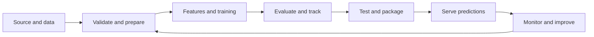

# MLOps Practical Lab

### From data preparation to model serving

A collection of **12 practical experiments** covering the core MLOps lifecycle. Each experiment has its own folder, instructions, required dependencies, and recorded result.

> **How to use this repository:** open an experiment below, read its `README.md`, and run its commands from that experiment's folder. Install only that experiment's `requirements.txt`, if it has one.

## Experiment index

| No. | Practical | What you will do | Report |
|:--:|---|---|:--:|
| 01 | MLOps foundations | Compare SDLC, DevOps and MLOps; map the lifecycle, challenges and tools | [Open](./experiment-01-mlops-introduction/) |
| 02 | Git and collaboration | Create commits and branches, merge changes and resolve a conflict | [Open](./experiment-02-git-github/) |
| 03 | Dataset versioning | Track dataset revisions with DVC and restore data from a local remote | [Open](./experiment-03-dvc/) |
| 04 | Data pipeline | Validate, split, transform and save a reproducible dataset | [Open](./experiment-04-data-pipeline/) |
| 05 | Feature store | Register features and retrieve offline and online values with Feast | [Open](./experiment-05-feature-store/) |
| 06 | Experiment tracking | Compare models, log metrics and artifacts, and register the selected model | [Open](./experiment-06-mlflow/) |
| 07 | Model selection | Compare a baseline with Grid Search and Random Search; log each run | [Open](./experiment-07-model-selection/) |
| 08 | Automated testing | Test data validation, model training and prediction outputs | [Open](./experiment-08-testing/) |
| 09 | Continuous integration | Run the practical's tests automatically with GitHub Actions | [Open](./experiment-09-ci/) |
| 10 | Docker packaging | Build and run a container for the model-serving application | [Open](./experiment-10-docker/) |
| 11 | REST API | Serve Iris predictions and check valid and invalid requests | [Open](./experiment-11-rest-api/) |
| 12 | Integrated workflow | Review evidence and dependencies across the practicals | [Open](./experiment-12-integrated-workflow/) |

## Lifecycle at a glance



## Repository structure

```text
experiment-01-mlops-introduction/
experiment-02-git-github/
...
experiment-12-integrated-workflow/
.github/workflows/       # Experiment 9: automated tests
.gitignore               # Excludes local environments and generated artifacts
```

## Results and scope

Each experiment's `OUTPUT.txt` records its demonstrated result. Local examples use sample datasets and local stores unless the report says otherwise. Docker execution is identified as **not verified** when Docker is unavailable; no unrun build or deployment is presented as successful.

The GitHub Actions workflow is in the root `.github/workflows/` directory so GitHub can discover and execute Experiment 9 automatically.
