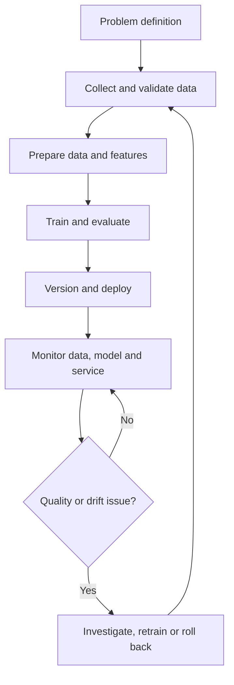

# Practical 01 | Introduction to MLOps

**Focus:** MLOps lifecycle, DevOps comparison, production challenges, tools and workflow design.

## Aim

Understand how machine-learning operations extend software development and DevOps to manage data, features, models and ongoing model performance.

## Topics covered

- **Software development:** builds and maintains application source code.
- **DevOps:** automates software integration, release and service operations.
- **MLOps:** applies these practices to code **and** data, features, models and their monitoring.
- Lifecycle: problem definition → data collection and validation → preprocessing and features → training and evaluation → versioning and deployment → monitoring and retraining.
- Production challenges: data or concept drift, training-serving skew, reproducibility, lineage, delayed labels and compute cost.
- Example tools: Git (source), DVC (data), Feast (features), MLflow (experiments and models), pytest/GitHub Actions (testing and CI), Docker (packaging), Flask (serving).

## Workflow



The source diagram is [`mlops-lifecycle.mmd`](./mlops-lifecycle.mmd).

## Requirements

- Python 3.10 or later; no third-party Python packages.

## Procedure

From this folder:

```powershell
python workflow_demo.py
```

Review the lifecycle stages printed in the terminal and compare them with the diagram and tool map above.

## Observed result

The script printed all six lifecycle stages. The captured run is in [`OUTPUT.txt`](./OUTPUT.txt). This is a conceptual walkthrough; it does not train or deploy a model.

## Conclusion

MLOps connects software delivery with data, feature, model and monitoring practices so that ML results can be reproduced, evaluated and operated.
