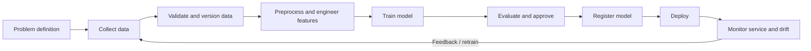

# Experiment 1 — Introduction to MLOps

## Aim
Study MLOps, compare software development, DevOps and MLOps, and map the machine-learning lifecycle.

## Theory
- **Software development:** designs, implements, tests and maintains software.
- **DevOps:** connects development and operations through collaboration, CI/CD, automation, monitoring and reliable releases.
- **MLOps:** applies engineering and operations practices to ML systems, including data/model versioning, training pipelines, model validation, deployment, monitoring, drift detection and retraining.
- **Lifecycle:** problem definition → data collection → validation → preparation/features → training → evaluation → model registry → deployment → monitoring → feedback/retraining.
- **Challenges:** changing data, data leakage, reproducibility, model/data drift, serving/training skew, latency, privacy, lineage and rollback.
- **Tools:** Git/GitHub, DVC, MLflow, scikit-learn, Docker, CI/CD, orchestration tools and monitoring systems.

## Workflow diagram

## Procedure
Run `python experiment-1-mlops-introduction/workflow_demo.py`.

## Result
The script prints the lifecycle stages and confirms that the demonstration completed. The output is a conceptual workflow demonstration, not a deployed production model.
