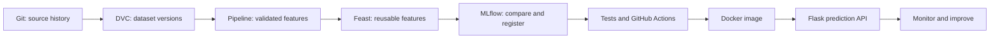

# Practical 12 | Integrated MLOps Workflow

**Focus:** connect version control, data and feature management, experiment tracking, testing, CI, packaging and serving.

## Aim

Review how the individual practicals fit together into an end-to-end ML delivery lifecycle and assess the evidence and boundaries of each demonstration.

## Workflow map

## Procedure

1. Run the practicals from folders `experiment-02` through `experiment-11`, following each folder's README.
2. Review each practical's `OUTPUT.txt` as the evidence record for that demonstration.
3. Compare the integrated summary in [`OUTPUT.txt`](./OUTPUT.txt) with the individual results.
4. Distinguish local demonstrations from shared or production infrastructure; note any component not executed in the available environment.

## Integrated result

The summary records the DVC data-version round trip, preprocessing counts, Feast retrieval, MLflow selection and registration, hyperparameter-search metrics, test results, CI evidence, and API responses.

**Boundary:** most integrations use local files, SQLite or a local test client. Docker execution is explicitly unverified when Docker is unavailable. This report consolidates evidence from the individual practicals; it does not claim a single automated production deployment.

## Conclusion

The practicals demonstrate how code, data, features, experiments, tests and serving can be connected and reviewed as a lifecycle. Reproducible local results are a foundation; shared production infrastructure and deployment require additional configuration.
